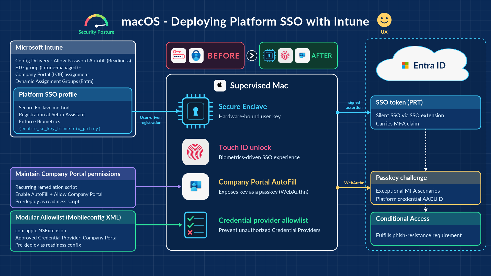

# macOS-Intune-PSSO-Readiness

**Enable Password AutoFill, register Company Portal as the credential provider, and control which apps may provide AutoFill — for macOS Platform SSO deployed with Microsoft Intune.**

[](https://support.apple.com/guide/deployment/welcome/web)
[](https://learn.microsoft.com/intune/)
[](scripts/Check-PSSO.zsh)
[](LICENSE)

---



## Overview

Platform SSO (PSSO) with the **Secure Enclave** method gives Macs passwordless, phishing-resistant sign-in to Microsoft Entra ID. For the cases where silent SSO is not enough — fresh / step-up MFA, browsers or apps without SSO-extension integration — Entra asks for a **passkey**. On macOS that passkey is the Platform Credential, exposed to WebAuthn through **AutoFill from Company Portal**.

Out of the box, users must enable that themselves in System Settings, and nothing stops other password managers being added as AutoFill providers. This repo closes both gaps:

| Resource | Type | What it does |
|---|---|---|
| [`scripts/Check-PSSO.zsh`](scripts/Check-PSSO.zsh) | Intune shell script (recurring) | Enables the main **AutoFill Passwords and Passkeys** toggle, registers and enables **Company Portal** as the AutoFill credential provider, and audits / disables unapproved providers |
| [`config/macOS-AutoFill-Provider-Allowlist.mobileconfig`](config/macOS-AutoFill-Provider-Allowlist.mobileconfig) | Intune custom profile (`com.apple.NSExtension`) | OS-enforced allowlist: blocks every AutoFill credential provider extension except Company Portal |

The script is the **corrective** layer (self-heals every 15 minutes); the profile is the **preventive** layer (users cannot override it). Use both.

## Prerequisites

- macOS 26 (Tahoe) or macOS 27 (Golden Gate). The script runs on macOS 13+, but only 26/27 were validated.
- Devices enrolled in Intune (ADE / supervised recommended).
- Company Portal **5.2404.0 or later** (ships `AutofillExtensionMacOS.appex`).
- Platform SSO configured with the **Secure Enclave** authentication method.
- Entra ID **Passkey (FIDO2)** authentication method enabled for the users. If you use key restrictions, allow the Platform Credential AAGUID `7FD635B3-2EF9-4542-8D9D-164F2C771EFC`.
- No MDM restriction setting `allowPasswordAutoFill = false` on the target devices (the script detects and honours it).

## Deploy the script

1. Intune admin center → **Devices › macOS › Scripts** (Shell scripts) → **Add**.
2. Upload `scripts/Check-PSSO.zsh` **as a file** — do not copy/paste the content (editors can change line endings and break it).
3. Settings:

   | Setting | Value |
   |---|---|
   | Run script as signed-in user | **No** (runs as root and acts in the signed-in user's context itself) |
   | Hide script notifications on devices | Yes |
   | Script frequency | **Every 15 minutes** |
   | Max number of times to retry if script fails | Not configured (the script always exits 0) |

4. Assign to your device group (for example a dynamic corporate macOS group).

### Configuration (top of the script)

| Variable | Default | Effect |
|---|---|---|
| `ENFORCE_MODE` | `false` | `false`: enable Company Portal once per user and re-check only after a macOS or Company Portal update; audit-only for the main toggle and unapproved providers. `true`: re-assert every run — turn the main toggle on and disable unapproved providers. |
| `ENABLE_BEFORE_PSSO` | `true` | Enable Company Portal AutoFill **before** PSSO registration completes (readiness for existing Macs). `false`: wait for registration. |
| `EXTRA_ALLOWED` | `()` | Additional approved provider bundle IDs, e.g. `EXTRA_ALLOWED=("com.vendor.app.autofill")`. Company Portal and Apple (`com.apple.*`) providers are always allowed. |

### What it does each run

1. Exits silently at the login window; exits silently if this user/macOS build/Company Portal version is already done (non-enforce mode).
2. Stops without changes if MDM blocks AutoFill (`allowPasswordAutoFill = false`) or if Company Portal is missing or not signed by Microsoft (Team ID `UBF8T346G9`).
3. Checks PSSO registration (`app-sso platform -s`).
4. Registers (if needed) and enables the Company Portal AutoFill extension, then verifies it.
5. Reads the main toggle (`com.apple.Safari AutoFillPasswords`) and, in enforce mode, turns it on.
6. Lists every AutoFill credential provider and, in enforce mode, disables any that is not approved.

Log: `/Library/Logs/Microsoft/IntuneScripts/checkPSSO/Check-PSSO.log`

## Deploy the allowlist profile

1. Intune admin center → **Devices › macOS › Configuration › Create › New policy** → **Templates › Custom**.
2. Deployment channel: **Device channel**. Upload `config/macOS-AutoFill-Provider-Allowlist.mobileconfig`.
3. Assign to the same device group as the script.

To approve another provider, add its bundle ID to `AllowedExtensions` in the profile **and** to `EXTRA_ALLOWED` in the script, then publish both as new versions. Find a provider's ID with:

```zsh
pluginkit -m -v -p com.apple.authentication-services-credential-provider-ui
```

Apple Passwords is built into macOS (not a credential-provider extension) and is not affected by the profile.

## Readiness rollout for existing Macs

For Macs already enrolled that will receive the PSSO policy later:

1. Deploy the profile and the script (`ENABLE_BEFORE_PSSO=true`) **first**.
2. Deploy the Platform SSO policy.

The PSSO registration workflow still shows its own "enable AutoFill" prompt even when Company Portal is already enabled — tell users they can **dismiss** it; nothing changes and the script keeps the state.

## Verify on a Mac

```zsh
# Latest run
awk '/run start ---/{buf=""} {buf=buf $0 "\n"} END{printf "%s", buf}' /Library/Logs/Microsoft/IntuneScripts/checkPSSO/Check-PSSO.log

# Company Portal provider state ('+' = enabled)
pluginkit -m -v -p com.apple.authentication-services-credential-provider-ui

# Main toggle (1 = on)
defaults read com.apple.Safari AutoFillPasswords
```

Functional test: My Account → **Security info** → on the MFA prompt choose **Sign in another way** → **Face, fingerprint, PIN or security key** → macOS shows *Passkey from Company Portal* → Touch ID.

Intune shows a recurring script's status only on its first run; use the local log for per-run results.

## Known limitations

- Enabling credential providers with `pluginkit` is not an Apple-documented management interface; re-validate on each major macOS release.
- Apple does not document how `AllowedExtensions` interacts with `DeniedExtensionPoints`; pilot the profile and smoke-test other extensions (Share menu, Finder, Safari extensions).
- Password managers can also fill via **Safari web extensions**, which neither resource controls.
- In audit mode a user can re-enable an unapproved provider; the profile is the hard control.

## Credits

Based on Microsoft's [shell-intune-samples — Set Autofill Automatically after PSSO Registration](https://github.com/microsoft/shell-intune-samples/tree/master/macOS/Config/Set%20Autofill%20Automatically%20after%20PSSO%20Registration) (MIT). Extended by Satish Singhi for recurring operation, macOS 26/27, readiness deployment, main-toggle enforcement and provider allowlisting.

## Disclaimer

Provided as-is, without warranty. Test in a pilot group before production use.

## License

[MIT](LICENSE)
